<div align="center">

# 🎮 CodeQuest 3D
### *Master Data Structures & Algorithms Through Immersive 3D Gaming*

[](https://github.com/shubhamjrd4559-sudo/Codequest-3d)
[](https://nextjs.org/)
[](https://react.dev/)
[](https://www.typescriptlang.org/)
[](https://tailwindcss.com/)
[](https://threejs.org/)
[](https://www.djangoproject.com/)
[](https://www.django-rest-framework.org/)
[](https://www.postgresql.org/)
[](https://github.com/shubhamjrd4559-sudo/Codequest-3d)

<br/>

**CodeQuest 3D** is an open-source, full-stack educational gaming web platform that transforms traditional computer science education into an interactive quest. Designed specifically for students and beginners, it replaces dry syntax memorization with 3D spatial simulations, animated mini-games, streak-powered daily challenges, and gamified quiz battlegrounds.

[Explore Documentation](./docs/README.md) · [Report Bug](https://github.com/shubhamjrd4559-sudo/Codequest-3d/issues) · [Request Feature](https://github.com/shubhamjrd4559-sudo/Codequest-3d/issues)

</div>

---

## 📑 Table of Contents

- [About CodeQuest 3D](#-about-codequest-3d)
- [The Problem We Solve](#-the-problem-we-solve)
- [Key Features](#-key-features)
  - [Implemented Features](#-implemented-features)
  - [Planned Features (Roadmap)](#-planned-features-roadmap)
- [Visual Showcase](#-visual-showcase)
- [Architecture & Tech Stack](#-architecture--tech-stack)
  - [High-Level System Architecture](#high-level-system-architecture)
  - [Technology Breakdown](#technology-breakdown)
- [Project Structure](#-project-structure)
- [Local Setup & Getting Started](#-local-setup--getting-started)
  - [Prerequisites](#prerequisites)
  - [1. Clone the Repository](#1-clone-the-repository)
  - [2. Backend Setup (Django & DRF)](#2-backend-setup-django--drf)
  - [3. Frontend Setup (Next.js & React)](#3-frontend-setup-nextjs--react)
- [Environment Variables](#-environment-variables)
- [3D Mini-Games Arcade](#-3d-mini-games-arcade)
- [Documentation Index](#-documentation-index)
- [Development Roadmap](#-development-roadmap)
- [Contributing](#-contributing)
- [License](#-license)
- [Author & Acknowledgments](#-author--acknowledgments)

---

## 💡 About CodeQuest 3D

Data Structures and Algorithms (DSA) form the foundation of computer science, yet traditional methods often present them as abstract pseudocode or intimidating terminal scripts. Beginners—especially students in classes 8 through 12 and university underclassmen—frequently struggle with mental visualization: *How does a call stack actually unwind? How does a pointer bridge memory nodes? How does binary search bisect search space in logarithmic time?*

**CodeQuest 3D** bridges this divide by turning abstract algorithmic concepts into tactile, 3D interactive challenges. Built with **Next.js 14**, **Three.js / React Three Fiber**, and **Django REST Framework**, the platform blends RPG-style progression (XP, levels, daily streaks, unlocked badges) with rigorous technical curriculum.

> [!NOTE]
> **Project Development Status: In Active Development.**  
> CodeQuest 3D is under active local development. Live deployment pipelines and production hosting are planned for upcoming phases.

---

## 🎯 The Problem We Solve

| Traditional Learning Obstacle | The CodeQuest 3D Solution |
|---|---|
| **Abstract Memory Models:** Pointers and memory frames are hard to visualize mentally. | **Interactive 3D Stages:** Real-time Three.js simulations render linked nodes, call stack blocks, and tree branches in 3D space. |
| **Boring Practice Drills:** Rote memorization leads to low student retention. | **Gamified Quizzes:** Candy Crush-style 4-tier progressive maps (Foundation → Core Logic → Pattern Builder → Grandmaster) with confetti and instant feedback. |
| **Inconsistent Study Habits:** Learners drop off after a few days without accountability. | **GitHub-Style Contribution Heatmap:** Daily challenges and streak multipliers encourage daily learning consistency. |
| **Disjointed Learning:** Switching between textbook theory, videos, and compilers causes cognitive overload. | **Integrated Hub:** Theory, visual simulations, video references, and hands-on arcade challenges unified in one cohesive cosmic UI. |

---

## ✨ Key Features

### 🚀 Implemented Features

- **🔐 Robust JWT Authentication:**
  - Secure registration, token obtain, refresh rotation, and logout with server-side token blacklisting.
  - Role-based authorization (`Student` vs `Admin`).
  - Pre-seeded one-click demo login (`hero@codequest.dev`) for rapid testing.

- **📊 Comprehensive Student Dashboard:**
  - Real-time XP, level computation, current streak, and activity trackers.
  - Daily Quick Quiz card integrated with backend date-rotated questions.
  - Interactive 3D Boy Character, Robot Mascot, and Floating Island artwork.

- **📅 Daily Quiz & GitHub-Style Heatmap:**
  - 200+ date-rotated questions seeded into the database.
  - Real-time streak tracking and +15 XP rewards per completion.
  - 365-day horizontal-scrolling contribution graph (`52 weeks × 7 days`) with glowing emerald activity cells and hover tooltips.

- **🗺️ Gamified 4-Tier Topic Quizzes:**
  - Visual Level Map with locked, unlocked, and completed stages.
  - Vibrantly colored MCQ option buttons with hover glows, confetti bursts on correct answers, and shake animations on mistakes.
  - Quiz HUD with lives (Hearts ❤️), timer (Hourglass ⏳), XP gain (Star ⭐), and live progress bars.

- **🕹️ 3D Mini-Games Arcade (Three.js & React Three Fiber):**
  - Dedicated 3D game shell with live game attempt score logging (`/api/v1/game-attempts/`).
  - Seven purpose-built 3D algorithm simulations:
    1. **Stack Tower** — LIFO push/pop mechanics with physical block placement.
    2. **Queue Ticket Counter** — FIFO service order visualizer.
    3. **Number Sorting** — Visual bar sorting with comparisons.
    4. **Linked List Node Connection** — Interactive node chaining and pointer updates.
    5. **Tree Traversal Challenge** — DFS/BFS node visitation across hierarchical branches.
    6. **Treasure Search** — Binary search narrowing on an interactive grid.
    7. **Logic Builder** — Conditional logic and algorithmic flow validation.

- **📖 Structured Learning Path & Lesson Reader:**
  - Hierarchical curriculum: Topics → Modules → Chapters → Lessons.
  - Rich lesson reader displaying formatted theory, real-world analogies, syntax-highlighted code blocks, and interactive visual preview cards.
  - Lesson completion tracking and bookmarking (`/api/v1/learning/lessons/{id}/bookmark/`).

- **🏆 Global Leaderboard & Achievements:**
  - Real-time Top 20 learner rankings by XP with Gold, Silver, and Bronze podium highlights.
  - Unlocked vs locked achievement badges grid with custom iconography and XP rewards.

- **🎬 Video Concept Help Library:**
  - Curated DSA video library with real-time topic search, glassmorphic cards, and YouTube video integration.

- **🎨 2026 Cosmic Glassmorphism UI:**
  - High-blur frosted glass panels (`backdrop-blur-2xl`), deep cosmic universe palette (`#070814`), and neon accents (Purple, Cyan, Amber, Emerald, Pink).
  - Radiating yellow glow branding: **CodeQuest by shubh5585**.

---

### 🔮 Planned Features (Roadmap)

- [ ] **In-Browser Code Execution Sandbox:** WebAssembly-powered C++ / Python code runner for instant compiler feedback.
- [ ] **Real-Time Multiplayer Quiz Battles:** WebSocket / Django Channels duel mode where students compete live against classmates.
- [ ] **Full 26-Topic Curriculum Expansion:** Comprehensive coverage of Graphs, Dynamic Programming, Segment Trees, and Disjoint Set Unions across all 4 quiz tiers.
- [ ] **Teacher / School Admin Portal:** Classroom management tools to assign custom topic quests and monitor class-wide progress heatmaps.
- [ ] **Mobile Native Experience:** Progressive Web App (PWA) with offline challenge caching and push streak reminders.
- [ ] **Automated CI/CD Deployment:** Dockerized multi-stage builds deployed on cloud infrastructure (e.g., AWS, Vercel, Fly.io).

---

## 📸 Visual Showcase

| Landing Page Hero | Student Command Dashboard |
|---|---|
| 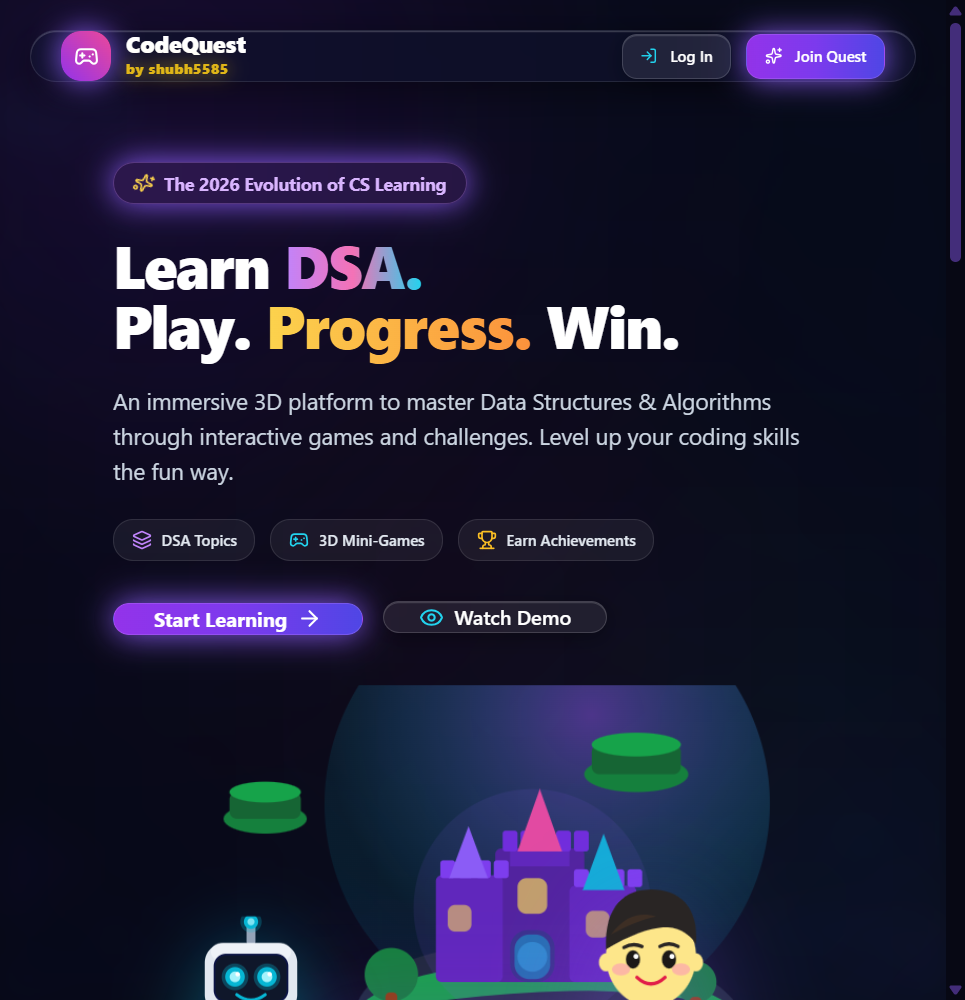 | 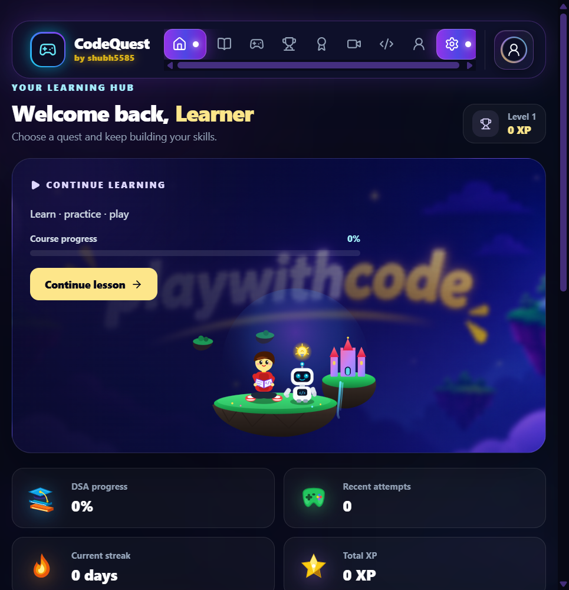 |

| 3D Mini-Game Gameplay (Stack Tower) | 3D Arcade Worlds Catalog |
|---|---|
| 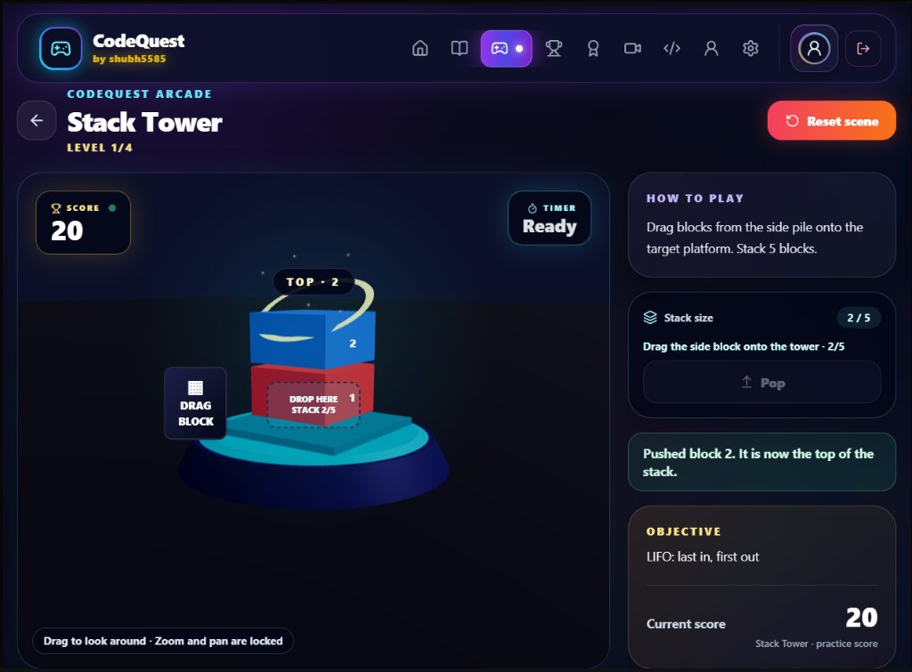 | 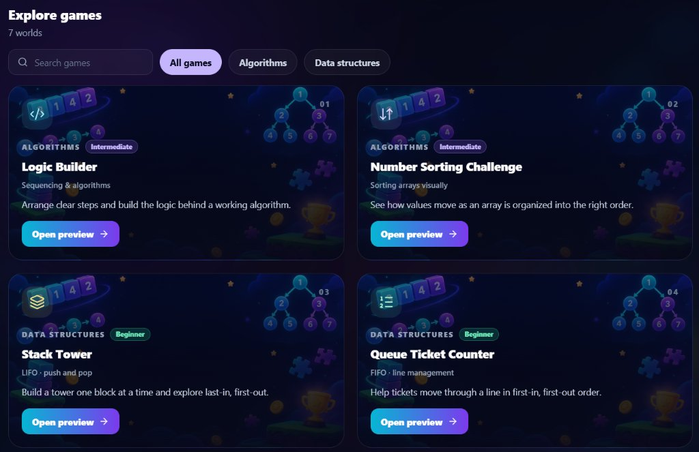 |

| Gamified Quiz Arena (Level Map & MCQs) | Study Roadmap & Learning Path |
|---|---|
| 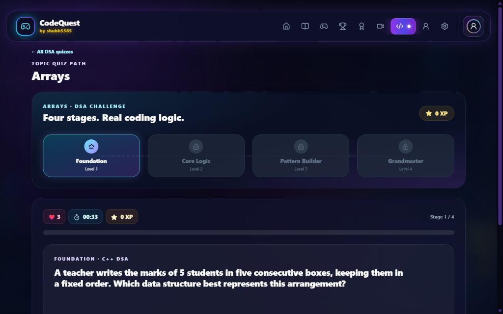 | 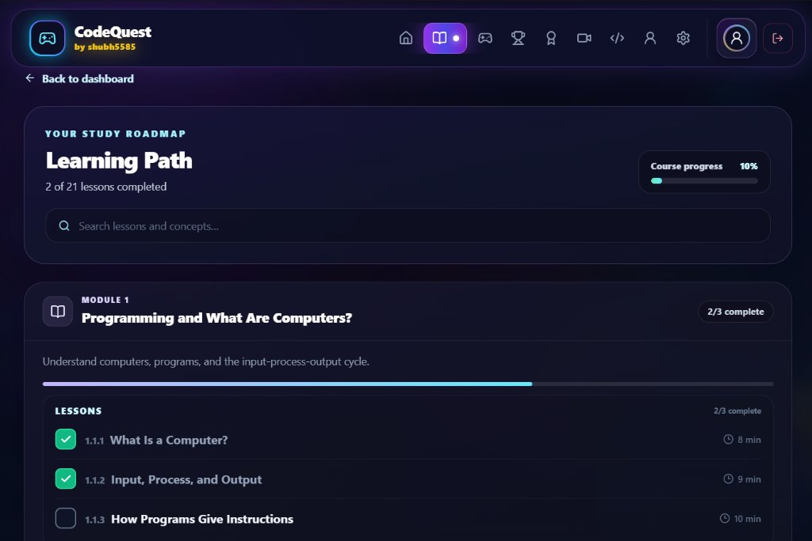 |

| Activity Heatmap (Last 365 Days) | Badges & Achievements Gallery |
|---|---|
| 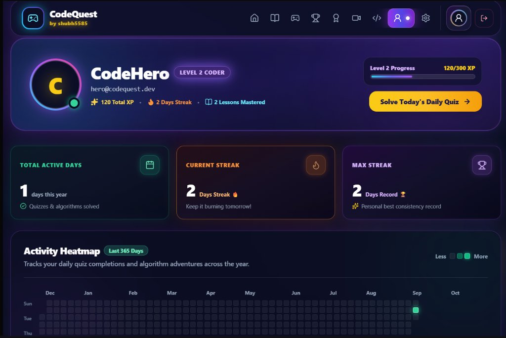 | 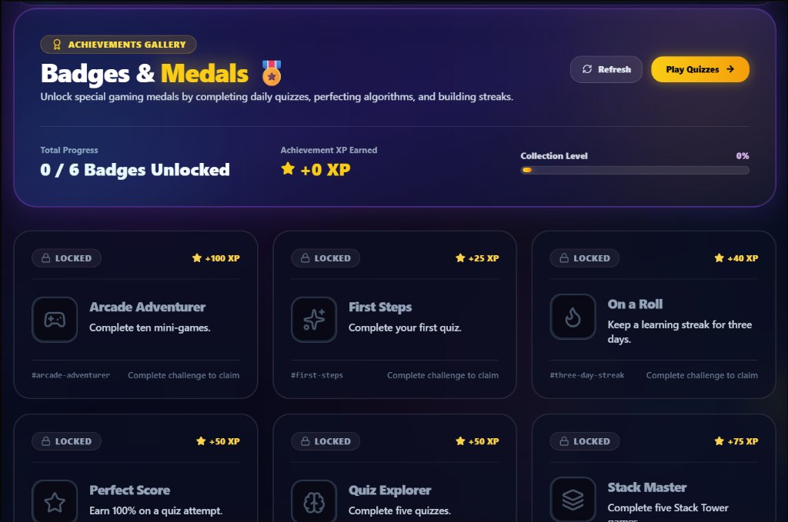 |

| Global Leaderboard Podium | Video Help & Concept Library |
|---|---|
| 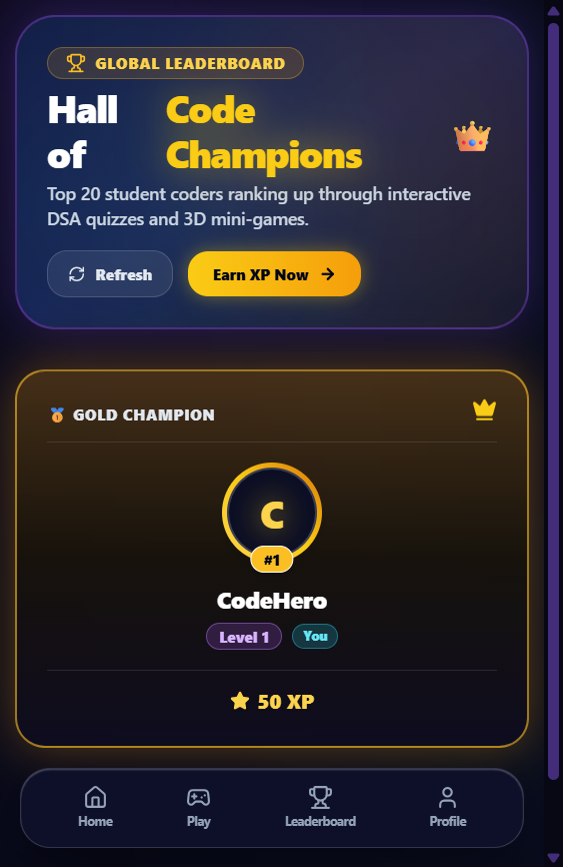 | 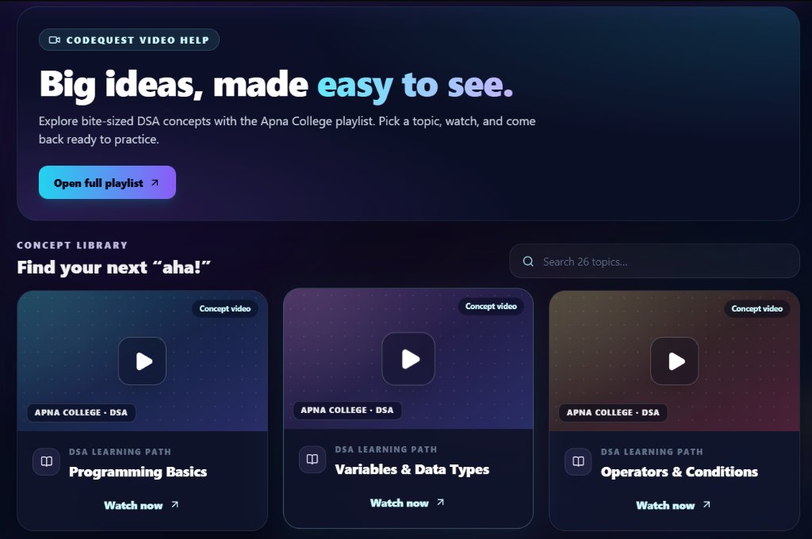 |

---

## 🏗️ Architecture & Tech Stack

### High-Level System Architecture

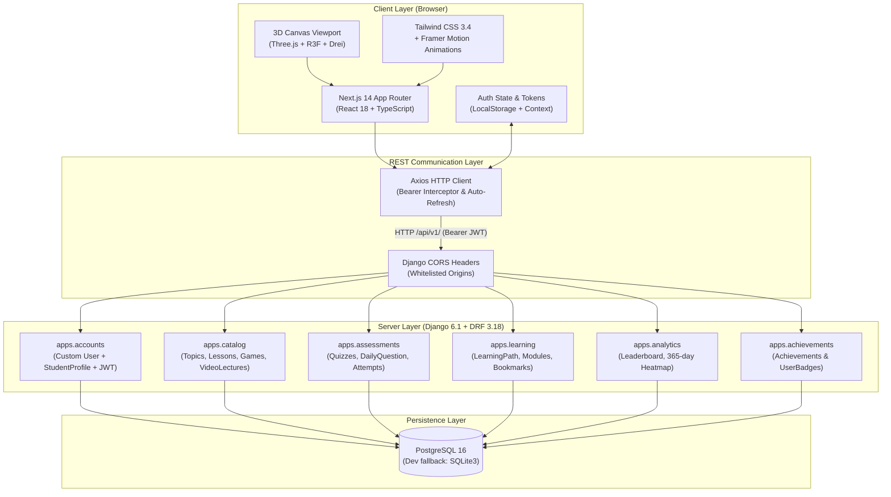

### Technology Breakdown

#### Frontend Architecture
- **Framework:** [Next.js 14.2](https://nextjs.org/) (App Router, Server & Client Components)
- **Language:** [TypeScript 5](https://www.typescriptlang.org/) (Strict type safety)
- **3D Graphics & Game Engine:** [Three.js](https://threejs.org/), [@react-three/fiber](https://r3f.docs.pmnd.rs/), [@react-three/drei](https://github.com/pmndrs/drei)
- **Styling & Theming:** [Tailwind CSS 3.4](https://tailwindcss.com/), PostCSS, Custom Cosmic Glassmorphic Design System
- **Animation Suite:** [Framer Motion 14](https://www.framer.com/motion/) (Spring physics, floating transitions, pulse glows)
- **Icons & UI Primitives:** [Lucide React](https://lucide.dev/), `clsx`, `tailwind-merge`, `class-variance-authority`
- **Data Fetching:** [Axios](https://axios-http.com/) with request/response interceptors and automated JWT refresh queuing

#### Backend Architecture
- **Runtime & Web Framework:** [Python 3.13](https://www.python.org/), [Django 6.1](https://www.djangoproject.com/)
- **API Framework:** [Django REST Framework 3.18](https://www.django-rest-framework.org/)
- **Authentication:** [djangorestframework-simplejwt 5.5](https://django-rest-framework-simplejwt.readthedocs.io/) (Rotating Refresh Tokens & Token Blacklisting)
- **Database Engine:** [PostgreSQL 16](https://www.postgresql.org/) via `psycopg2-binary` (Development supported via SQLite)
- **Security & Headers:** `django-cors-headers 4.9`, custom password validators, environment isolation via `python-dotenv`

---

## 📁 Project Structure

```text
CodeQuest-3D/
├── backend/                        # Django REST Framework backend
│   ├── apps/
│   │   ├── accounts/               # Custom User model, StudentProfile, JWT auth endpoints
│   │   ├── achievements/           # Achievement definitions and user awards
│   │   ├── analytics/              # Global Leaderboard and 365-day Activity Heatmap
│   │   ├── assessments/            # Quizzes, questions, attempts, and daily quiz rotation
│   │   ├── catalog/                # Topics, lessons, 3D games, game levels, and video lectures
│   │   └── learning/               # Learning paths, modules, chapters, bookmarks, and attempts
│   ├── config/                     # Django core settings, WSGI/ASGI, and root URL router
│   ├── daily_questions.json        # 200 pre-seeded date-rotated C++ & DSA questions
│   ├── quiz_data.json              # Topic quiz curriculum seed data
│   ├── fix_and_seed.py             # Database seed script for topics, lessons, and quizzes
│   ├── seed_daily_questions.py     # Database seed script for 200 daily questions
│   ├── manage.py                   # Django CLI entrypoint
│   └── .env.example                # Backend environment template
│
├── frontend/                       # Next.js 14 App Router frontend
│   ├── app/
│   │   ├── (auth)/                 # Login & Registration views with glassmorphic cards
│   │   ├── (public)/               # Public marketing landing page & feature showcase
│   │   ├── (student)/              # Authenticated student application shell
│   │   │   ├── dashboard/          # Student mission control & summary stats
│   │   │   ├── learning/           # Learning path curriculum & lesson viewer
│   │   │   ├── mini-games/         # 3D Arcade portal & individual game shells
│   │   │   ├── quizzes/            # Gamified topic quizzes with Candy Crush level maps
│   │   │   ├── leaderboard/        # Global Top 20 XP rankings
│   │   │   ├── achievements/       # Badges showcase
│   │   │   ├── profile/            # User profile & GitHub-style activity heatmap
│   │   │   └── videos/             # Video lecture search & library
│   │   └── layout.tsx              # Root HTML layout and font loading
│   ├── components/                 # Reusable UI component library
│   │   ├── characters/             # 3D character illustrations (Boy, Mascot, Floating Island)
│   │   ├── dashboard/              # Dashboard widgets & Daily Quiz cards
│   │   ├── games/                  # 3D game shell and catalog definitions
│   │   ├── illustrations/          # 3D stages and isometric art
│   │   ├── profile/                # Activity heatmap component
│   │   ├── quiz/                   # Quiz HUD, Level Map, Confetti, and MCQ buttons
│   │   └── ui/                     # Atoms: Button, Card, Badge, Input, NavigationBar, Sidebar
│   ├── games/                      # 3D Three.js / React Three Fiber interactive game scenes
│   │   └── scenes/                 # StackTower, QueueCounter, LinkedList, TreeTraversal, etc.
│   ├── lib/api/                    # Axios HTTP client, token management, and API services
│   ├── design-system/              # Design tokens and theme specifications
│   ├── public/                     # Static media assets and artwork
│   └── package.json                # Frontend dependencies and npm scripts
│
├── docs/                           # Comprehensive technical documentation
│   ├── ARCHITECTURE.md             # System architecture, data flow & security design
│   ├── FEATURES.md                 # Detailed feature breakdown and status
│   ├── SETUP.md                    # In-depth local setup and troubleshooting
│   ├── DEVELOPMENT.md              # Coding standards, Git flow & conventions
│   ├── PROJECT_STRUCTURE.md        # Comprehensive file tree reference
│   ├── ROADMAP.md                  # Development phases, history & milestones
│   └── images/                     # Documentation screenshots and visual assets
│
├── .github/                        # GitHub issue templates and PR guidelines
│   ├── ISSUE_TEMPLATE/
│   │   ├── bug_report.md           # Bug report issue template
│   │   └── feature_request.md      # Feature request issue template
│   └── PULL_REQUEST_TEMPLATE.md    # Pull request review checklist
│
├── CONTRIBUTING.md                  # Open-source contribution guidelines
├── CODE_OF_CONDUCT.md              # Contributor Covenant Code of Conduct
├── SECURITY.md                     # Vulnerability reporting policy
├── CHANGELOG.md                    # Project change history and release notes
├── LICENSE                         # MIT License
└── README.md                       # Repository root documentation (this file)
```

---

## ⚡ Local Setup & Getting Started

Follow the steps below to run CodeQuest 3D locally on your machine.

### Prerequisites

Ensure you have the following installed:
- **Node.js:** `v18.18.0` or higher (Node `v20+` recommended) — [Download Node.js](https://nodejs.org/)
- **npm:** `v9+` (packaged with Node.js)
- **Python:** `v3.11`, `v3.12`, or `v3.13` — [Download Python](https://www.python.org/)
- **Git:** [Download Git](https://git-scm.com/)
- *(Optional)* **PostgreSQL:** `v15+` (SQLite works out-of-the-box for development)

---

### 1. Clone the Repository

```bash
git clone https://github.com/shubhamjrd4559-sudo/Codequest-3d.git
cd Codequest-3d
```

---

### 2. Backend Setup (Django & DRF)

Open a terminal in the project root:

```bash
# 1. Navigate to the backend directory
cd backend

# 2. Create a Python virtual environment
python -m venv .venv

# 3. Activate the virtual environment
# On Windows (PowerShell):
.venv\Scripts\Activate.ps1
# On Windows (Command Prompt):
.venv\Scripts\activate.bat
# On macOS / Linux:
source .venv/bin/activate

# 4. Install backend dependencies
pip install asgiref Django django-cors-headers djangorestframework djangorestframework-simplejwt psycopg2-binary PyJWT python-dotenv sqlparse

# 5. Create environment configuration
cp .env.example .env

# 6. Apply database migrations
python manage.py migrate

# 7. Seed curriculum data and 200 daily questions
python fix_and_seed.py
python seed_daily_questions.py

# 8. (Optional) Create an admin superuser
python manage.py createsuperuser

# 9. Start the Django development server
python manage.py runserver 8000
```

The backend API will be available at: **`http://localhost:8000/api/v1/`**  
The Django Admin panel is available at: **`http://localhost:8000/admin/`**

---

### 3. Frontend Setup (Next.js & React)

Open a **separate** terminal in the project root:

```bash
# 1. Navigate to the frontend directory
cd frontend

# 2. Install dependencies
npm install

# 3. Start the Next.js development server
npm run dev
```

The frontend web app will be accessible at: **`http://localhost:3000`**

> [!TIP]
> **Instant Testing with Demo Account:**  
> On the login page (`http://localhost:3000/login`), click **"Use Demo Account"** to instantly sign in with `hero@codequest.dev` (pre-seeded with initial XP and streak data).

---

## ⚙️ Environment Variables

### Backend Configuration (`backend/.env`)

| Variable | Default Value | Description |
|---|---|---|
| `DJANGO_SECRET_KEY` | `replace-with-a-strong-random-secret` | Cryptographic secret for signing sessions and tokens |
| `DJANGO_DEBUG` | `true` (dev) / `false` (prod) | Django debug mode flag |
| `DJANGO_ALLOWED_HOSTS` | `localhost,127.0.0.1` | Comma-separated list of valid host headers |
| `DATABASE_ENGINE` | `sqlite` (or `postgres`) | Database provider toggle |
| `POSTGRES_DB` | `codequest3d` | PostgreSQL database name (if using Postgres) |
| `POSTGRES_USER` | `codequest` | PostgreSQL username |
| `POSTGRES_PASSWORD` | `replace-with-a-password` | PostgreSQL password |
| `POSTGRES_HOST` | `localhost` | PostgreSQL host address |
| `POSTGRES_PORT` | `5432` | PostgreSQL port |
| `CORS_ALLOWED_ORIGINS` | `http://localhost:3000` | Whitelisted origins permitted to make cross-origin requests |
| `API_PAGE_SIZE` | `20` | Default page size for paginated DRF list responses |

### Frontend Configuration (`frontend/.env.local`)

| Variable | Default Value | Description |
|---|---|---|
| `NEXT_PUBLIC_API_URL` | `http://localhost:8000/api/v1` | Base REST API URL consumed by the Axios client |

---

## 🕹️ 3D Mini-Games Arcade

The 3D Arcade (`/mini-games`) delivers interactive algorithm visualizations rendered with WebGL using Three.js and React Three Fiber:

| Mini-Game | Core DSA Concept | Interactive Mechanics | Scene Implementation |
|---|---|---|---|
| **Stack Tower** | Stacks (LIFO) | Push and pop colored geometry blocks onto a physics tower with stack-overflow and stack-underflow detection. | [`StackTowerScene.tsx`](./frontend/games/scenes/StackTowerScene.tsx) |
| **Queue Counter** | Queues (FIFO) | Enqueue customer tokens and dequeue in first-in-first-out order at an interactive station. | [`QueueCounterScene.tsx`](./frontend/games/scenes/QueueCounterScene.tsx) |
| **Number Sorting** | Sorting Algorithms | Visual array representation with swap indicators demonstrating Bubble Sort and comparative sorting logic. | [`NumberSortingScene.tsx`](./frontend/games/scenes/NumberSortingScene.tsx) |
| **Linked List** | Singly Linked Lists | Interactive memory nodes with dynamic pointer arrows that chain and rearrange upon insertion. | [`LinkedListScene.tsx`](./frontend/games/scenes/LinkedListScene.tsx) |
| **Tree Traversal** | Binary Trees | Branching 3D node tree highlighting Pre-Order, In-Order, Post-Order, and Level-Order traversals. | [`TreeTraversalScene.tsx`](./frontend/games/scenes/TreeTraversalScene.tsx) |
| **Treasure Search** | Binary Search | Low/High pointer narrowing on an interactive geometric search grid to find hidden keys in $O(\log n)$ steps. | [`TreasureSearchScene.tsx`](./frontend/games/scenes/TreasureSearchScene.tsx) |
| **Logic Builder** | Algorithmic Flow | Logic gate puzzle requiring learners to route signals using conditionals and boolean logic. | [`LogicBuilderScene.tsx`](./frontend/games/scenes/LogicBuilderScene.tsx) |

---

## 📚 Documentation Index

For in-depth architectural specifications, API schemas, and development guidelines, explore the `docs/` folder:

- **[System Architecture (`docs/ARCHITECTURE.md`)](./docs/ARCHITECTURE.md)** — Architectural patterns, data models, JWT token lifecycles, and security practices.
- **[Feature Catalog (`docs/FEATURES.md`)](./docs/FEATURES.md)** — Comprehensive breakdown of all implemented and upcoming features.
- **[Local Setup & Troubleshooting (`docs/SETUP.md`)](./docs/SETUP.md)** — Step-by-step setup guides for Windows, macOS, and Linux, plus common troubleshooting tips.
- **[Developer Guide (`docs/DEVELOPMENT.md`)](./docs/DEVELOPMENT.md)** — Coding conventions, Git workflow, testing instructions, and pull request procedures.
- **[Project Directory Reference (`docs/PROJECT_STRUCTURE.md`)](./docs/PROJECT_STRUCTURE.md)** — Detailed walk-through of the directory tree and file responsibilities.
- **[Development Roadmap (`docs/ROADMAP.md`)](./docs/ROADMAP.md)** — Phase-by-phase release milestones and strategic vision.
- **[REST API Reference (`docs/api/endpoints.md`)](./docs/api/endpoints.md)** — Exhaustive list of v1 API endpoints with sample payloads and status codes.

---

## 🗺️ Development Roadmap

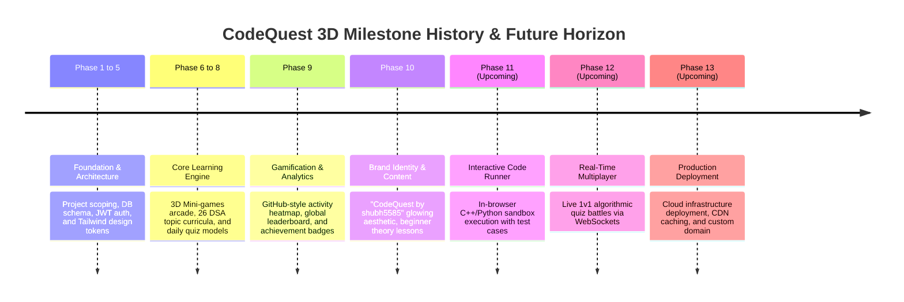

---

## 🤝 Contributing

Contributions make the open-source community an incredible place to learn, inspire, and create. Any contributions you make are **greatly appreciated**.

Please see our **[Contributing Guide (`CONTRIBUTING.md`)](./CONTRIBUTING.md)** for detailed instructions on:
1. Forking the repository and creating a feature branch.
2. Code style, linting, and TypeScript guidelines.
3. Commit message standards and Pull Request requirements.

Please also read our **[Code of Conduct (`CODE_OF_CONDUCT.md`)](./CODE_OF_CONDUCT.md)** to understand our community standards.

---

## 🔒 Security

For instructions on reporting security vulnerabilities, please refer to our **[Security Policy (`SECURITY.md`)](./SECURITY.md)**.

---

## 📄 License

CodeQuest 3D is developed as an open-source educational project. An open-source license (such as MIT) is slated for formalization upon production release. See [License details](https://github.com/shubhamjrd4559-sudo/Codequest-3d).

---

## 👤 Author & Acknowledgments

**CodeQuest 3D** is designed, developed, and maintained by:

- **Lead Architect & Developer:** **Shubham ([@shubh5585](https://github.com/shubhamjrd4559-sudo))**
- **GitHub Repository:** [https://github.com/shubhamjrd4559-sudo/Codequest-3d](https://github.com/shubhamjrd4559-sudo/Codequest-3d)

Special thanks to the open-source communities behind **Next.js**, **Three.js**, **React Three Fiber**, **Tailwind CSS**, and **Django REST Framework** whose tools power this educational platform.

<div align="center">
  <sub>Built with ❤️ and passion for the next generation of software engineers.</sub>
</div>
