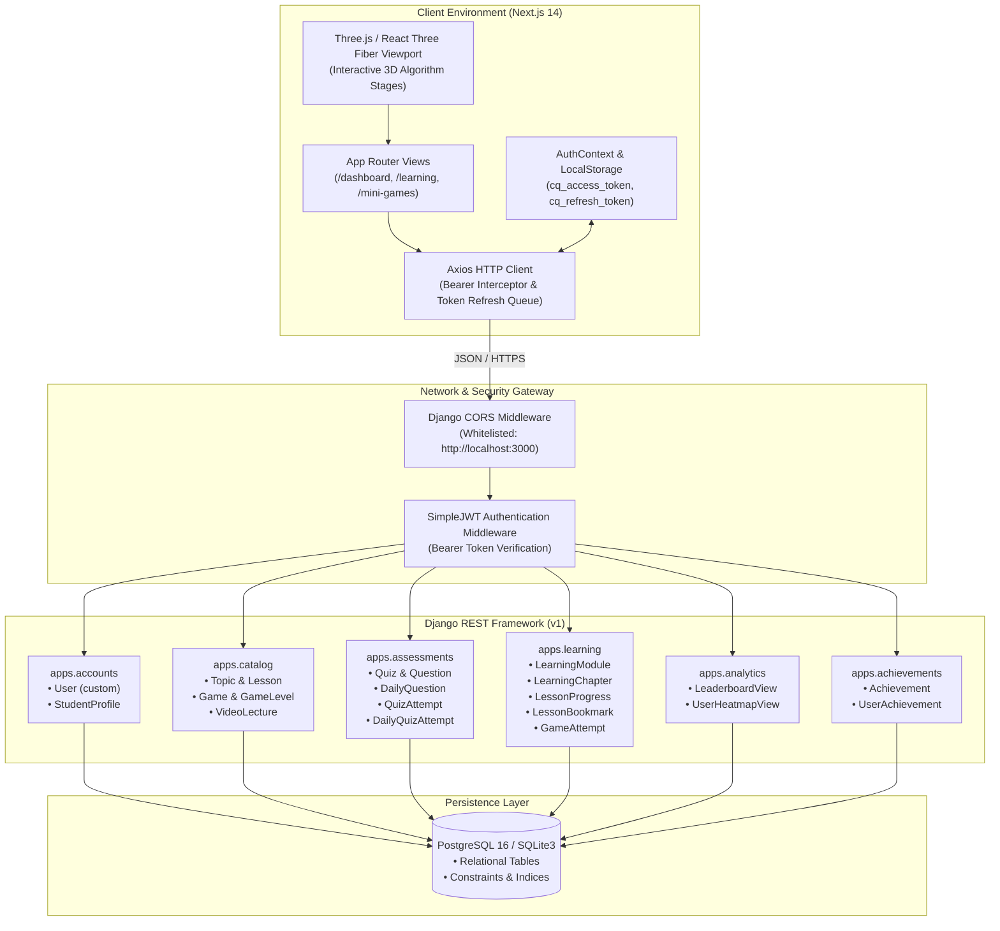
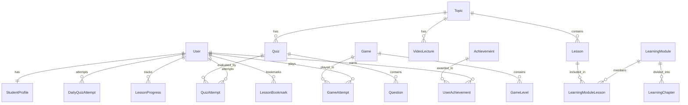
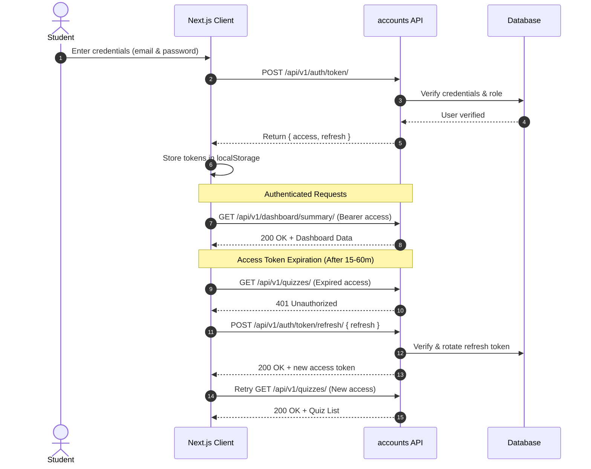

# 🏗️ CodeQuest 3D — System Architecture & Design

This document details the architectural blueprint, data flow patterns, security boundaries, and database entity relationships of the **CodeQuest 3D** platform.

---

## 📑 Table of Contents

- [Architectural Philosophy](#-architectural-philosophy)
- [System Overview](#-system-overview)
- [Client Layer (Frontend)](#-client-layer-frontend)
- [API & Network Gateway](#-api--network-gateway)
- [Server Layer (Backend)](#-server-layer-backend)
- [Data Models & Entity Relationships](#-data-models--entity-relationships)
- [Authentication & JWT Lifecycle](#-authentication--jwt-lifecycle)
- [Security & Access Controls](#-security--access-controls)
- [Performance & 3D Optimization](#-performance--3d-optimization)

---

## 🌟 Architectural Philosophy

CodeQuest 3D is designed as a **decoupled full-stack application**. The frontend owns user experience, spatial 3D interaction, client routing, and animations, while the backend acts as a hardened REST API service owning identity, scoring integrity, curriculum records, and analytics.

Key design principles:
1. **Strict Separation of Concerns:** The browser never accesses the database directly. All interactions flow through versioned REST endpoints (`/api/v1/`).
2. **Stateless Authentication:** User sessions are backed by cryptographically signed JSON Web Tokens (JWT), allowing horizontal API scaling.
3. **Optimistic & Resilient Client UI:** Interceptors handle automatic token refresh without interrupting the user's active game or quiz session.
4. **Progressive 3D Enhancement:** WebGL canvases run within isolated boundaries, ensuring UI stability even on lower-end devices.

---

## 🏛️ System Overview

---

## 💻 Client Layer (Frontend)

The frontend is constructed using **Next.js 14.2** utilizing the App Router architecture:

- **Route Grouping:**
  - `app/(auth)/` — Unauthenticated views (Login, Registration) with cosmic backdrop art and demo access buttons.
  - `app/(public)/` — Landing page showcasing features, value propositions, and interactive previews.
  - `app/(student)/` — Protected authenticated shell sharing a unified sidebar, HUD, and session listener.
- **Component Hierarchy:**
  - **Atoms (`components/ui/`):** Glassmorphic buttons, inputs, badges, cards, navigation bars, and glowing headers.
  - **Molecules & Organisms (`components/quiz/`, `components/profile/`, `components/dashboard/`):** Candy Crush-style Level Maps, MCQ buttons, HUD timers, and 365-day SVG heatmaps.
  - **Characters & Artwork (`components/characters/`, `components/illustrations/`):** Procedural 3D Boy, Robot Mascot, and Floating Islands.
- **3D Mini-Games Engine (`games/scenes/`):**
  - Powered by `@react-three/fiber` and `@react-three/drei`.
  - Self-contained scenes with camera controls, physical mesh animations, and algorithmic event triggers.

---

## 🔄 API & Network Gateway

All HTTP traffic is mediated by an Axios singleton (`frontend/lib/api/client.ts`):

1. **Request Interceptor:**
   - Reads `cq_access_token` from `localStorage`.
   - Appends `Authorization: Bearer <token>` to all protected outbound calls.
2. **Response Interceptor:**
   - Detects `401 Unauthorized` responses.
   - Transparently queues incoming requests while triggering a token refresh to `POST /api/v1/auth/token/refresh/`.
   - Replays queued requests upon receiving a new access token.
   - Clears credentials and redirects to `/login` if refresh token is expired or revoked.

---

## ⚙️ Server Layer (Backend)

The backend is built with **Django 6.1** and **Django REST Framework 3.18**, structured into six domain-specific applications:

| App Name | Path | Core Responsibility |
|---|---|---|
| `accounts` | `backend/apps/accounts/` | Custom `User` model, `StudentProfile` with streak/XP calculations, JWT token lifecycle. |
| `catalog` | `backend/apps/catalog/` | Curriculum taxonomy (`Topic`, `Lesson`, `Game`, `GameLevel`, `VideoLecture`). |
| `assessments` | `backend/apps/assessments/` | Topic quizzes, questions, daily C++ quiz queue (`DailyQuestion`), attempt logging. |
| `learning` | `backend/apps/learning/` | Structured curriculum navigation (`LearningModule`, `LearningChapter`), progress toggling, bookmarks, and game score attempts. |
| `analytics` | `backend/apps/analytics/` | Aggregated reporting: Global Top 20 Leaderboard and 365-day Activity Heatmap (`/api/v1/user/heatmap/`). |
| `achievements` | `backend/apps/achievements/` | Badges, criteria definitions, and user achievement awards. |

---

## 🗄️ Data Models & Entity Relationships

---

## 🔐 Authentication & JWT Lifecycle

---

## 🛡️ Security & Access Controls

- **Role-Based Access Control (RBAC):** Users are classified as `student` or `admin`. Administrative routes require `is_staff=True`.
- **CORS Policies:** Configured via `django-cors-headers` to strictly permit origin `http://localhost:3000` during development.
- **SQL Injection Prevention:** Built entirely with Django ORM parameterized queries; raw SQL is prohibited.
- **Password Policies:** Validated through Django's standard validators: Minimum length, numeric-only rejection, common password checks, and attribute similarity tests.
- **Token Blacklisting:** Revoked refresh tokens are committed to a server-side blacklist table on `/api/v1/auth/logout/`.

---

## ⚡ Performance & 3D Optimization

1. **Lazy Loading of 3D Canvases:** WebGL components use Next.js dynamic imports (`next/dynamic` with `ssr: false`) to avoid server-side rendering errors and defer heavy canvas initialization until the component enters the DOM.
2. **Asset Optimization:** Background nebulas, isometric illustrations, and game textures use compressed PNGs with CSS blur filters instead of multi-megabyte heavy geometry wherever appropriate.
3. **Database Indexing:** Composite indices on foreign keys and frequently filtered querysets (e.g. `user + status`, `role + is_active`, `-total_xp`) ensure $O(\log n)$ performance on leaderboard and heatmap lookups.
